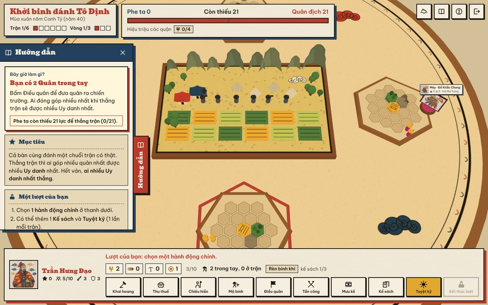
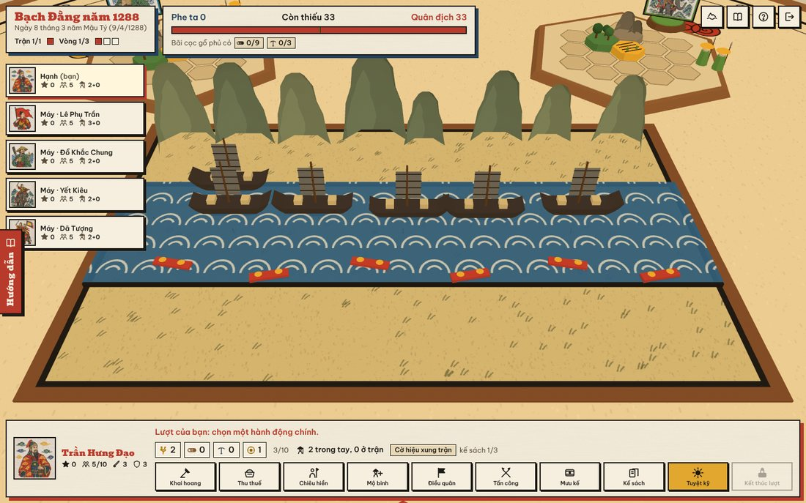
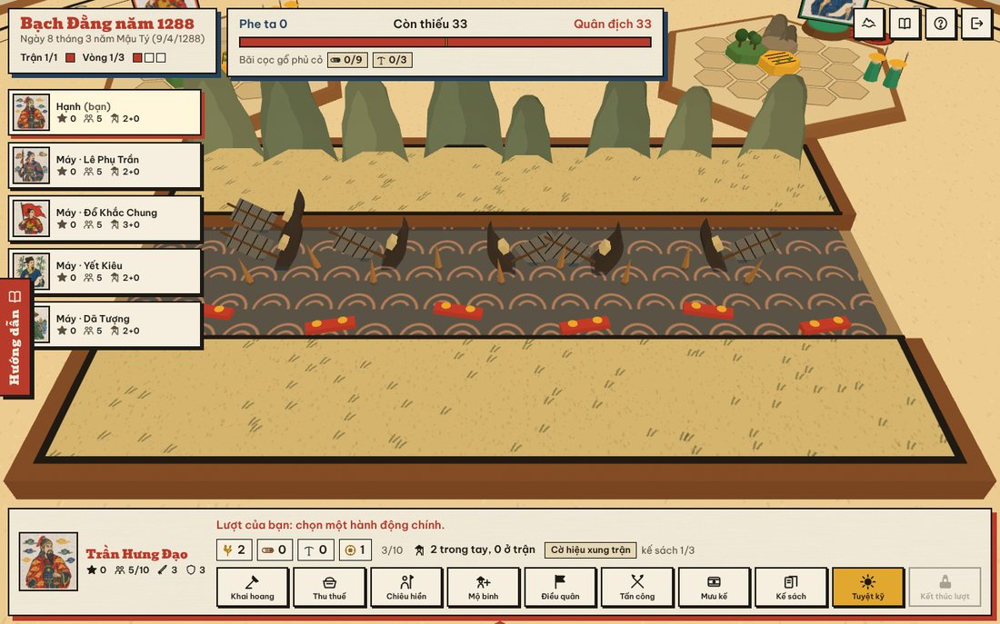
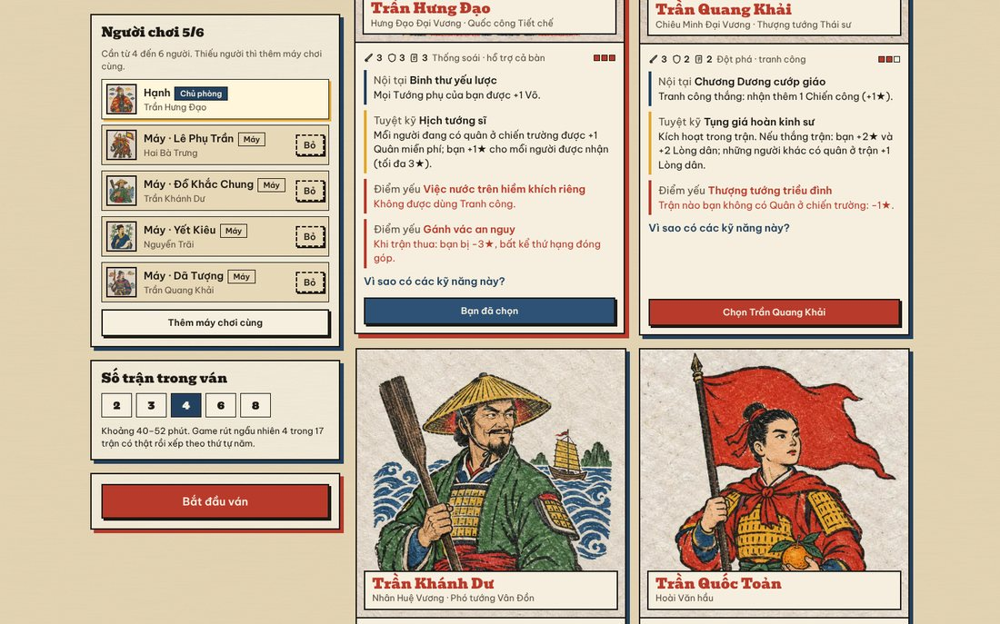
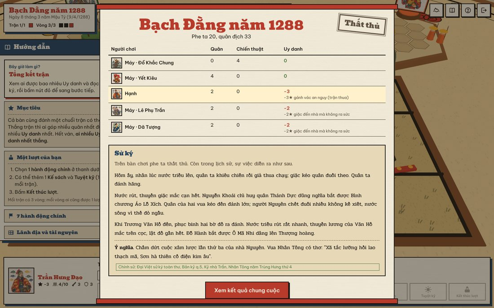
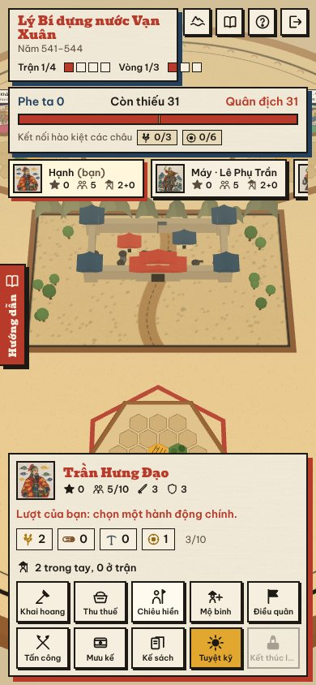

# Hào Khí Ngàn Năm — Board game online 3D về lịch sử Việt Nam

🎮 **Chơi ngay:** https://hao-khi-ngan-nam.hao-khi-ngan-nam.workers.dev

Board game chiến thuật **4–6 người** chơi online. Mỗi người là một anh hùng trong sử Việt, cùng nhau đánh các trận có thật nhưng **tranh nhau công trạng**. Ai có nhiều **Uy danh ★** nhất thì thắng. Nội dung sử trích từ **Đại Việt sử ký toàn thư**.

**Bản hiện tại:** 17 trận có thật, từ Hai Bà Trưng khởi binh (năm 40) đến Ngọc Hồi – Đống Đa (1789). Chủ phòng chọn ván dài **2, 3, 4, 6 hoặc 8 trận**; game rút ngẫu nhiên rồi xếp theo thứ tự năm. 8 anh hùng: Trần Hưng Đạo, Trần Quang Khải, Trần Khánh Dư, Trần Quốc Toản, Trần Thủ Độ, Hai Bà Trưng, Bà Triệu, Nguyễn Trãi, mỗi người một chân dung riêng.

Toàn bộ giao diện vẽ theo **tranh dân gian Đông Hồ**: nền giấy dó, nét mực đen, màu son, chàm, vàng hoè, xanh lá; khung in khắc gỗ, bóng in lệch màu, bộ biểu tượng vẽ riêng.

| Sa bàn | Bạch Đằng 1288 | Triều rút, giặc mắc cọc |
|---|---|---|
|  |  |  |
| **Sảnh chờ** | **Sử ký sau trận** | **Điện thoại** |
|  |  |  |

## Có gì trong bản này
- **Sa bàn 3D kiểu đồ chơi gỗ sơn màu**: bàn gỗ trải bản đồ giấy dó có mây cuộn, sóng nước. Mọi vật thể tô màu phẳng 3 mảng sáng tối và có viền mực như tranh in.
- **Chiến trường dựng theo địa hình từng trận**: sông (sóng vảy cá, thủy triều), đầm lầy (lau sậy, thuyền độc mộc), ải núi (núi đá vôi, cổng ải), thành (tường, tháp góc, cổng hai tầng mái), đồng bằng (ruộng, nhà mái cong, trại giặc).
- **Hoạt cảnh theo sử**: ở Bạch Đằng, ta thắng thì triều rút, lộ bãi cọc, thuyền giặc lật trên cọc. Đánh thành thắng thì cờ giặc hạ, cờ ta kéo lên. Thua thì quân giặc tiến lên bờ ta.
- **Tượng đứng in chân dung** từng anh hùng trên bàn mỗi người, luôn quay về phía người xem. Quân lính gỗ mang màu anh hùng, bay vòng cung ra trận. Giấy màu bung ra khi thắng, mực đen tung khi thua.
- **Phòng chơi online**: vào trang, điền tên, tạo phòng hoặc nhập mã phòng, gửi link mời. Chủ phòng chọn số trận và thêm **máy chơi cùng** cho đủ 4–6 người. Mất mạng thì vào lại đúng ghế cũ; người rời đi quá 25 giây thì máy tự chơi thay.
- **Chơi thử với máy**: không cần máy chủ, chạy ngay trong trình duyệt. Muốn dạy đúng một bài thì chọn sẵn trận qua địa chỉ, ví dụ `?tran=bachDang1288,chiLang1427` (tên các trận ở `src/engine/content/battles.ts`).
- **Học sử khi chơi**: mỗi trận có cuộn giấy *Bối cảnh* và *Sử ký* trích Toàn thư (trận 1789 theo Cương mục). Mỗi kỹ năng có mục "Vì sao" kèm nguồn. Mọi thông tin gắn nhãn **Chính sử** hoặc **Tương truyền**.
- Bảng **Hướng dẫn** bên trái màn hình nói ngắn gọn lúc này nên làm gì.
- Tự giảm hiệu ứng trên điện thoại (tắt viền mực, bớt hạt). Thêm `?hieuung=cao` hoặc `?hieuung=thap` vào link để chỉnh tay.

## Bản xem trước (chơi với máy)
`npm run build:single` tạo một file duy nhất `dist-single/index.html`. File này chạy được mà không cần máy chủ (chỉ chế độ chơi với máy). Bản này đã được đăng lên claude.ai để chơi thử ngay.

## Chạy trên máy của bạn
Cần Node.js 20 trở lên.

```bash
npm install
```

```bash
npm run build
```

```bash
npx wrangler dev
```

Mở http://localhost:8787. Cả phòng chơi online lẫn chế độ chơi với máy đều chạy ở đây.

Khi đang sửa giao diện, chạy `npx wrangler dev` ở một cửa sổ và `npm run dev` ở cửa sổ khác, rồi mở http://localhost:5173 (Vite tự chuyển `/api` sang wrangler).

## Đưa lên Cloudflare cho bạn bè cùng chơi

### Cách 1 — Tự động mỗi lần đẩy code lên GitHub (khuyên dùng)
1. Đăng nhập https://dash.cloudflare.com (tài khoản miễn phí là đủ).
2. Vào **Workers & Pages** → **Create** → **Import a repository** → kết nối GitHub và chọn repo `boardgameonline`.
3. Điền:
   - **Build command:** `npm run build`
   - **Deploy command:** `npx wrangler deploy`
4. Bấm **Deploy**. Cloudflare cấp một địa chỉ dạng `https://hao-khi-ngan-nam.<tên-bạn>.workers.dev`. Gửi địa chỉ này cho bạn bè.

Từ đó, mỗi lần đẩy code lên nhánh `main`, Cloudflare tự build và cập nhật.

### Cách 2 — Deploy bằng lệnh
```bash
npx wrangler login
```

```bash
npm run deploy
```

> Phòng chơi dùng **Durable Objects** (bản SQLite), có trong gói miễn phí của Cloudflare Workers.

## Cấu trúc
```
src/engine/        Luật chơi (TypeScript thuần, dùng chung cho server và trình duyệt)
  content/         Anh hùng, tướng phụ, kế sách, trận đánh (kèm nguồn Toàn thư)
  rules.ts         Hành động, giao chiến, giải quyết trận, tính điểm
  bots.ts          Máy chơi cùng
src/net/           Giao thức phòng chơi + phòng chạy trong trình duyệt
src/client/        Giao diện React + cảnh 3D (scene/) + bảng điều khiển (ui/)
  art/heroes/      Chân dung 8 anh hùng kiểu tranh Đông Hồ (vẽ bằng Figma AI)
worker/index.ts    Cloudflare Worker + Durable Object "Room"
tests/             Test luật chơi + mô phỏng cân bằng
docs/              Thiết kế game, luật, trích dẫn Toàn thư
```

## Kiểm tra
```bash
npm test
```

```bash
SIM=1 npx vitest run tests/simulate.test.ts --silent=false
```

Lệnh thứ hai cho máy tự chơi 400 ván để xem tỉ lệ thắng của từng anh hùng. Lần chạy gần nhất: các anh hùng thắng trong khoảng 16–28%; trận đầu ván thắng khoảng 82%, trận thứ 8 khoảng 57% (giặc mạnh dần theo ván).

## Tài liệu
- [Luật chơi đầy đủ — Hào Khí Ngàn Năm](docs/hao-khi-ngan-nam/README.md)
- [Anh hùng](docs/hao-khi-ngan-nam/nhan-vat.md) · [Trận đánh](docs/hao-khi-ngan-nam/tran-danh.md)
- [Trích dẫn nguyên văn Đại Việt sử ký toàn thư](docs/nguon-toan-thu.md)
