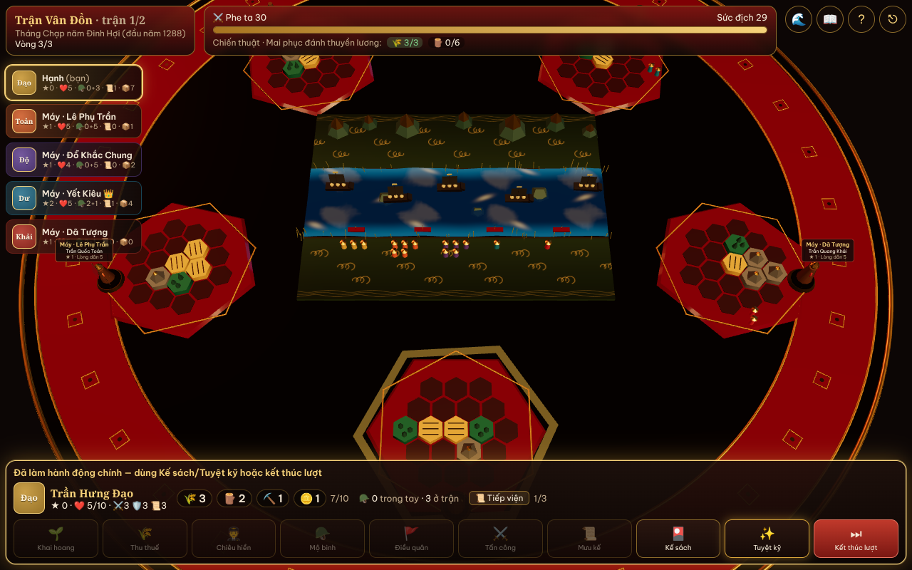
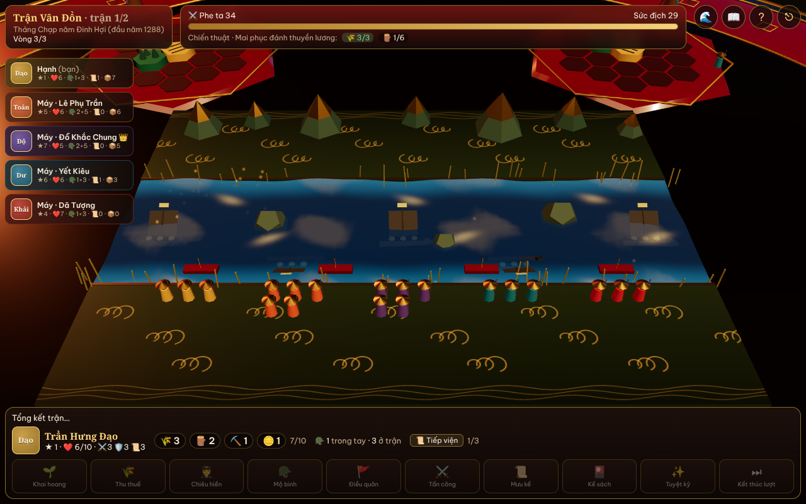
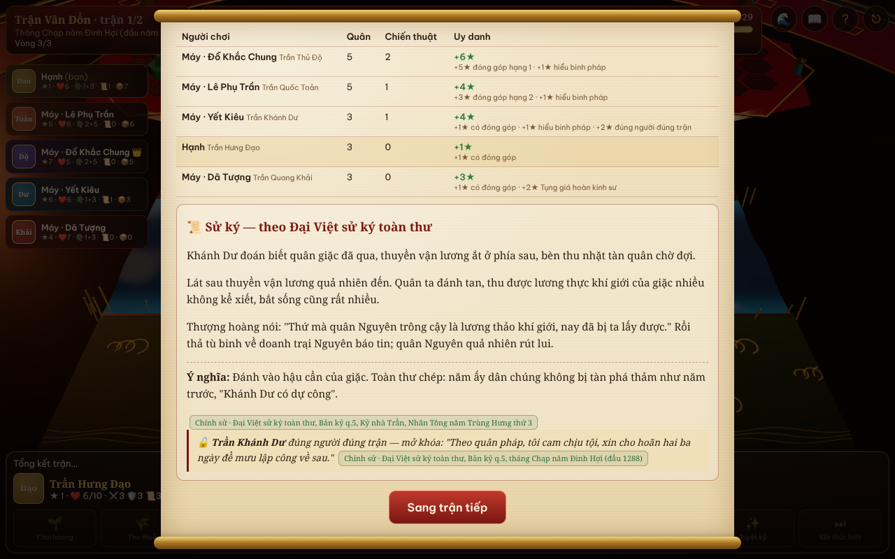
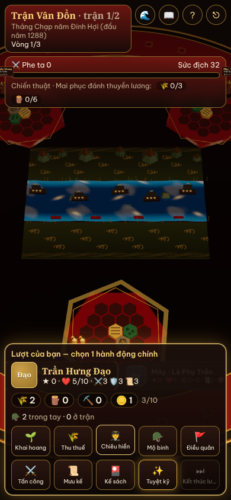

# Hào Khí Ngàn Năm — Board game online 3D về lịch sử Việt Nam

Board game chiến thuật **4–6 người** chơi online. Mỗi người là một anh hùng trong sử Việt, cùng nhau đánh các trận có thật nhưng **tranh nhau công trạng**. Ai có nhiều **Uy danh ★** nhất thì thắng. Nội dung sử trích từ **Đại Việt sử ký toàn thư**.

**Bản chơi thử hiện tại:** thời Trần, gồm 2 trận **Vân Đồn** và **Bạch Đằng 1288**, với 8 anh hùng (Trần Hưng Đạo, Trần Quang Khải, Trần Khánh Dư, Trần Quốc Toản, Trần Thủ Độ, Hai Bà Trưng, Bà Triệu, Nguyễn Trãi).

| Sa bàn | Chiến trường Vân Đồn | Sử ký sau trận | Điện thoại |
|---|---|---|---|
|  |  |  |  |

## Có gì trong bản này
- **Sa bàn 3D sơn mài** (Three.js / React Three Fiber): bàn đen bóng viền son và vàng, lá vàng bay, sông có sóng, thủy triều rút để lộ bãi cọc Bạch Đằng, thuyền giặc mắc cọc lật đổ, quân lính bằng gỗ bay vòng cung ra trận, tượng gỗ của từng anh hùng, hiệu ứng bụi vàng, vòng sóng tuyệt kỹ, rung camera khi giao chiến.
- **Phòng chơi online**: vào trang, điền tên, tạo phòng hoặc nhập mã phòng, gửi link mời cho bạn bè. Chủ phòng thêm **máy chơi cùng** cho đủ 4–6 người. Mất mạng thì vào lại được đúng ghế cũ; người rời đi quá 25 giây thì máy tự chơi thay.
- **Chơi thử với máy**: không cần máy chủ, chạy ngay trong trình duyệt.
- **Học sử khi chơi**: mỗi trận có cuộn giấy *Bối cảnh* và *Sử ký* trích Toàn thư. Mỗi kỹ năng có mục "Vì sao" kèm nguồn. Mọi thông tin gắn nhãn **Chính sử** hoặc **Tương truyền**.
- Tự giảm hiệu ứng trên điện thoại. Thêm `?hieuung=cao` hoặc `?hieuung=thap` vào link để chỉnh tay.

## Chạy trên máy của bạn
Cần Node.js 20 trở lên.

```bash
npm install
```

```bash
npm run build
```

```bash
npx wrangler dev
```

Mở http://localhost:8787. Cả phòng chơi online lẫn chế độ chơi với máy đều chạy ở đây.

Khi đang sửa giao diện, chạy `npx wrangler dev` ở một cửa sổ và `npm run dev` ở cửa sổ khác, rồi mở http://localhost:5173 (Vite tự chuyển `/api` sang wrangler).

## Đưa lên Cloudflare cho bạn bè cùng chơi

### Cách 1 — Tự động mỗi lần đẩy code lên GitHub (khuyên dùng)
1. Đăng nhập https://dash.cloudflare.com (tài khoản miễn phí là đủ).
2. Vào **Workers & Pages** → **Create** → **Import a repository** → kết nối GitHub và chọn repo `boardgameonline`.
3. Điền:
   - **Build command:** `npm run build`
   - **Deploy command:** `npx wrangler deploy`
4. Bấm **Deploy**. Cloudflare cấp một địa chỉ dạng `https://hao-khi-ngan-nam.<tên-bạn>.workers.dev`. Gửi địa chỉ này cho bạn bè.

Từ đó, mỗi lần đẩy code lên nhánh `main`, Cloudflare tự build và cập nhật.

### Cách 2 — Deploy bằng lệnh
```bash
npx wrangler login
```

```bash
npm run deploy
```

> Phòng chơi dùng **Durable Objects** (bản SQLite), có trong gói miễn phí của Cloudflare Workers.

## Cấu trúc
```
src/engine/        Luật chơi (TypeScript thuần, dùng chung cho server và trình duyệt)
  content/         Anh hùng, tướng phụ, kế sách, trận đánh (kèm nguồn Toàn thư)
  rules.ts         Hành động, giao chiến, giải quyết trận, tính điểm
  bots.ts          Máy chơi cùng
src/net/           Giao thức phòng chơi + phòng chạy trong trình duyệt
src/client/        Giao diện React + cảnh 3D (scene/) + bảng điều khiển (ui/)
worker/index.ts    Cloudflare Worker + Durable Object "Room"
tests/             Test luật chơi + mô phỏng cân bằng
docs/              Thiết kế game, luật, trích dẫn Toàn thư
```

## Kiểm tra
```bash
npm test
```

```bash
SIM=1 npx vitest run tests/simulate.test.ts --silent=false
```

Lệnh thứ hai cho máy tự chơi 400 ván để xem tỉ lệ thắng của từng anh hùng. Lần chạy gần nhất: các anh hùng thắng trong khoảng 15–26%; trận Vân Đồn thắng 64–72%, trận Bạch Đằng 48–60%.

## Tài liệu
- [Luật chơi đầy đủ — Hào Khí Ngàn Năm](docs/hao-khi-ngan-nam/README.md)
- [Anh hùng](docs/hao-khi-ngan-nam/nhan-vat.md) · [Trận đánh](docs/hao-khi-ngan-nam/tran-danh.md)
- [Trích dẫn nguyên văn Đại Việt sử ký toàn thư](docs/nguon-toan-thu.md)
